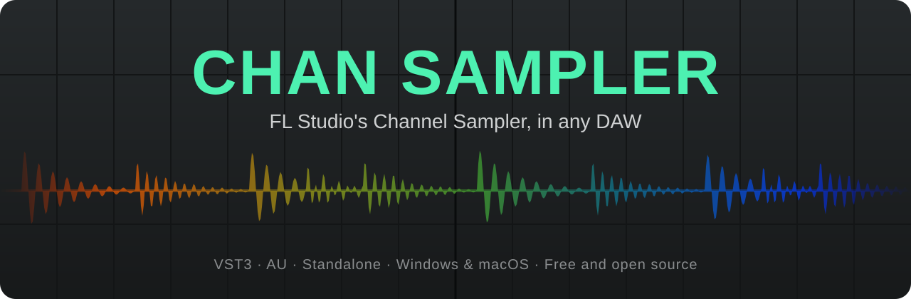
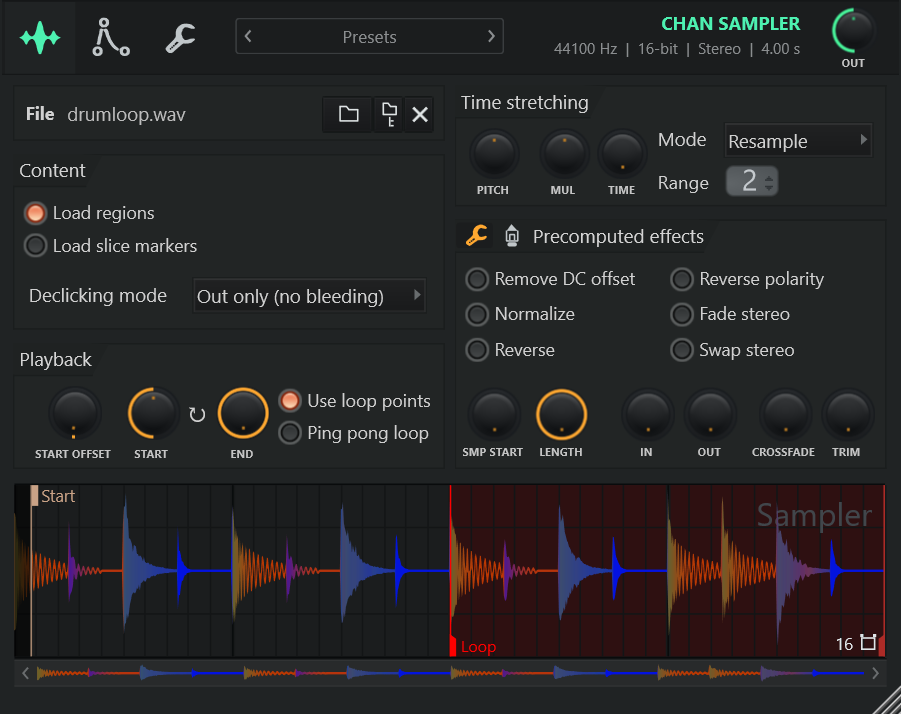
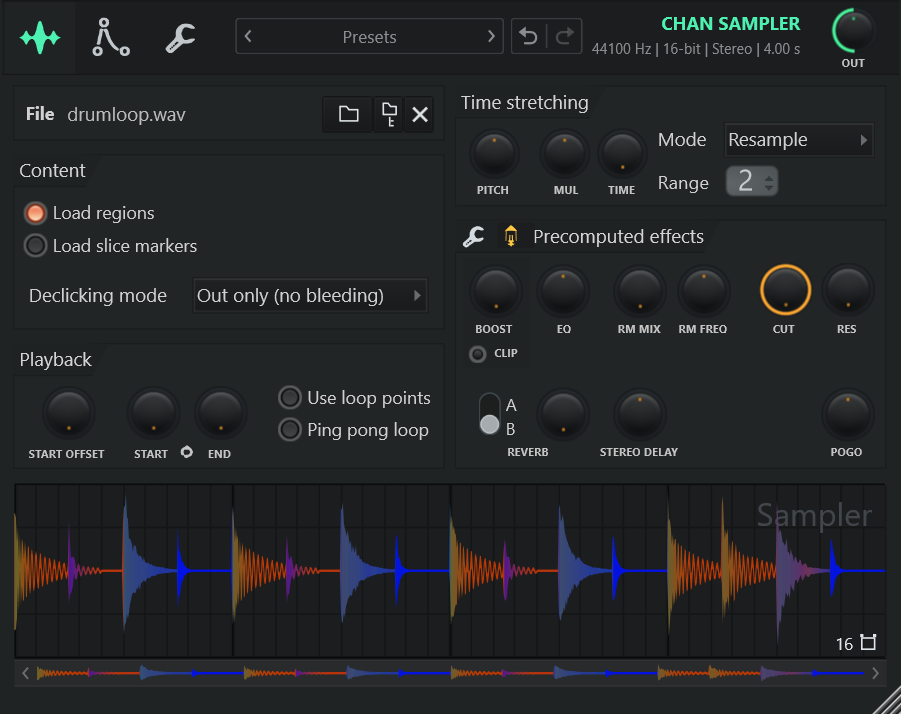
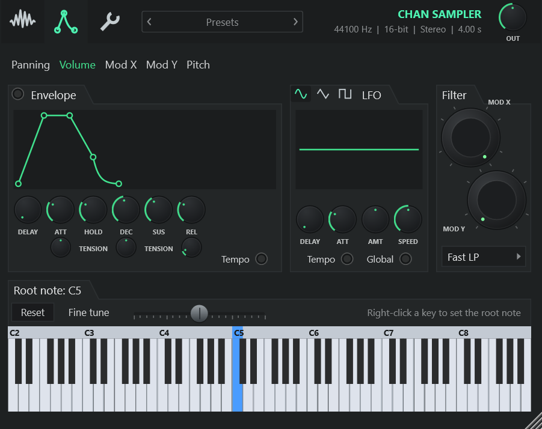
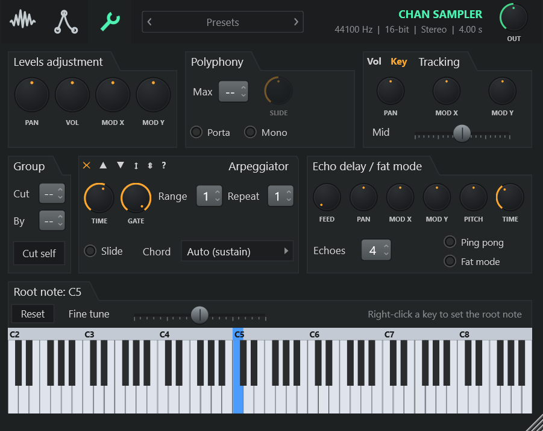
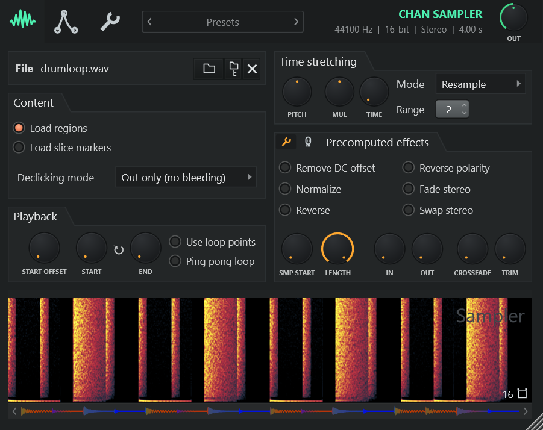
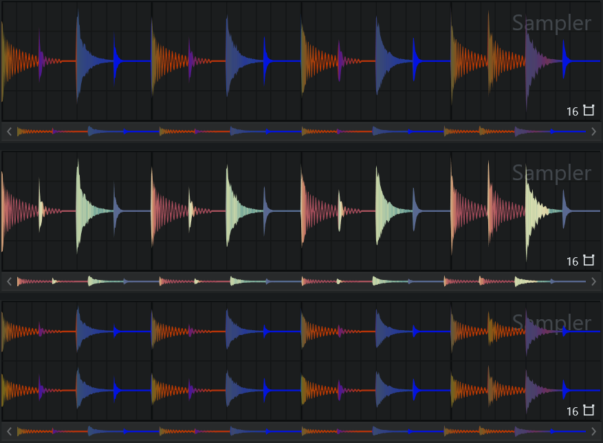

<p align="center">
  <picture>
    <source media="(prefers-color-scheme: dark)" srcset="docs/banner.svg">
    <source media="(prefers-color-scheme: light)" srcset="docs/banner-light.svg">
    
  </picture>
</p>

<p align="center">
  <a href="https://github.com/MaymiPR/ChanSampler/releases/latest"></a>
  <a href="https://github.com/MaymiPR/ChanSampler/actions/workflows/ci.yml"></a>
  <a href="LICENSE"></a>
</p>

**Chan Sampler** is a free, open-source recreation of FL Studio 26.1.7's Channel
Sampler. It runs as a VST3, CLAP, AU or standalone app on Windows, macOS and
Linux.

Every knob uses FL's units, and the engine was measured against FL itself.
Most features render sample-identically to FL. FL Sampler presets (`.fst`)
load with their sample.



> Chan Sampler is an independent project. Image-Line does not make, endorse or
> support it, and it contains no Image-Line code, samples or presets.

## How it was made

Chan Sampler was created entirely with Claude (Anthropic's AI) and
[REA](https://github.com/morluto/rea): the code, the measurements behind it and
this documentation. FL Studio was the reference throughout, as described in
[docs/EVIDENCE.md](docs/EVIDENCE.md).

## Features

- **FL's playback:** start offset, loop points, ping-pong loop and FL's six
  declicking modes.
- **FL presets:** drop an FL Sampler preset (`.fst`) on the window to get its
  sample and every setting.
- **Precomputed effects:** normalize, reverse, fades, crossfade, trim, reverb,
  stereo delay and more, rendered into the sample as FL does.
- **Time stretching:** PITCH, MUL and TIME with Resample, Stretch, Stretch Pro,
  the e3 modes, slice stretch and slice map.
- **Modulation:** envelopes for volume, Mod X, Mod Y and pitch, LFOs for those
  and panning, tempo sync, and eight filter types.
- **Misc:** polyphony with mono, porta and slide, velocity and key tracking,
  cut groups, an arpeggiator with chords, and echo with fat mode.
- **FL's sample view:** zoom, markers, spectrum and multichannel views, and
  colourful waveforms.
- **FL's look and feel:** controls drawn as FL draws them, down to the hover
  fades and the wheel glide. The window resizes and stays sharp on high-DPI
  screens.
- **Undo and redo** with FL's keys, which also work inside FL Studio.
- **Files:** WAV (including FL's compressed WAVs), AIFF, FLAC, Ogg Vorbis and
  MP3, with region and slice markers and loop points read from the file.

| Precomputed effects | Envelopes, LFOs and filter |
|:---:|:---:|
|  |  |
| **Levels, arpeggiator and echo** | **Spectrum view** |
|  |  |

## Quick start

1. Download the file for your system from the
   [latest release](https://github.com/MaymiPR/ChanSampler/releases/latest):

   | System | File | Contents |
   |---|---|---|
   | Windows (x64) | `ChanSampler-<version>-Windows-Setup.exe` | Installer for the VST3, CLAP and standalone app |
   | macOS 10.13 or later (universal) | `ChanSampler-<version>-macOS.pkg` | Installer for the AU, VST3, CLAP and app (pick which) |
   | Linux (x86-64, glibc 2.35 or later) | `ChanSampler-<version>-Linux.tar.gz` | VST3, CLAP and standalone app to copy |

2. On Windows and macOS, run the installer. On Linux, run this in the folder
   that holds the download:

   ```bash
   tar -xzf ChanSampler-*-Linux.tar.gz
   cd "Chan Sampler (Linux)"
   mkdir -p ~/.vst3 ~/.clap
   cp -r "Chan Sampler.vst3" ~/.vst3/
   cp "Chan Sampler.clap" ~/.clap/
   ```

3. Rescan plugins in your DAW and add **Chan Sampler** to an instrument track.
   Drop a sample on its window and play.

Chan Sampler is not code-signed, so your system warns you the first time:

- **Windows SmartScreen:** click *More info*, then *Run anyway*.
- **macOS 15 and later:** open it once, then go to System Settings > Privacy &
  Security and click *Open Anyway*. On earlier versions, right-click it and
  choose *Open*.

Each release lists SHA-256 checksums in `SHA256SUMS.txt`, so you can check a
download.

## Usage

| To | Do this |
|---|---|
| Load a sample | Drop an audio file on the window, or click the folder button. |
| Load an FL preset | Drop an `.fst` file on the window, or import it from the preset menu. |
| Hear the sample | Click the waveform. It plays at the root note. |
| Set the start and loop | Drag the Start flag and the loop markers in the sample view. |
| Zoom the sample view | Scroll over it. |
| Edit the sample elsewhere | Drag the waveform out to your DAW, an audio editor or a folder. When the file is saved there, it reloads here with your settings. |
| Use the sample view's tools | Right-click it: Reload, Save as, Locate file, Copy, Paste, Detect tempo, Get properties and the view options. |
| Fine-tune a knob | Ctrl + drag. |
| Step a knob | Scroll over it. |
| Reset a knob | Alt + click, or right-click it and choose *Reset*. |
| Type a knob's value | Right-click it and choose *Type in value*. |
| Undo / redo | Ctrl+Z / Ctrl+Y (or Ctrl+Shift+Z), or the arrows beside the presets. Use Cmd on macOS. |
| See the version and About | Click **CHAN SAMPLER** in the top bar. |

Without the volume envelope, a note plays to the end of the sample, as in FL.

### Presets

The bar at the top saves and loads `.cspreset` files in
`Documents/Chan Sampler/Presets`. Subfolders become submenus, and the arrows
step through the presets.

The **Factory** presets hold settings only, so they keep your sample: *Chop*
(the sample lasts exactly as long as the note), *Pluck*, *Swell*,
*Filter sweep*, *Wobble 1/8*, *Tremolo*, *Vibrato*, *808 glide*,
*Echo ping-pong 1/8* and *Reverse*.

### Waveform colours

Right-click the sample view and choose *Colorful waveforms* to colour the
waveform by its sound. From top to bottom: Multiband (the default), Color map,
and Multiband in the multichannel view.



## How close is it to FL?

Each feature was checked with null tests: the same notes rendered through FL's
Sampler and through Chan Sampler inside FL, then subtracted. The precomputed
effects, interpolation, envelopes, LFOs, filters, loops, tracking, glide, echo,
most of the arpeggiator and the compressed formats null against FL. The sample
view's colours, grid and spectrum were measured from FL's screen.

Known gaps:

- **Time stretching** (any mode but Resample) behaves like FL's but doesn't
  match it sample for sample. FL's engine (elastique) is proprietary, so
  Chan Sampler uses its own algorithms.
- **FL-only features** that need FL as the host are left out: the Time panel
  (gate, shift, swing) and the knob menus' automation and remote-control
  entries. Your DAW provides those.

[docs/EVIDENCE.md](docs/EVIDENCE.md) lists every measurement and every known
gap.

## Build from source

You need CMake 3.22 or later, Git and a C++ compiler. JUCE downloads
automatically. On Linux:

```bash
cmake -B build -DCMAKE_BUILD_TYPE=Release
cmake --build build --target ChanSampler_VST3 ChanSampler_CLAP ChanSampler_Standalone
```

[docs/BUILDING.md](docs/BUILDING.md) has the Windows and macOS commands and the
Linux packages to install first.

## Contributing

Found a bug or a difference from FL's Sampler? Open an
[issue](https://github.com/MaymiPR/ChanSampler/issues/new/choose) and attach a
sample or an `.fst` preset that shows it. To change the code, read
[CONTRIBUTING.md](CONTRIBUTING.md) for the tests, the null tests against FL and
the release steps. Changes per version are in [CHANGELOG.md](CHANGELOG.md).

## License

Chan Sampler is free software under the
[GNU Affero General Public License v3](LICENSE). It is built with
[JUCE](https://juce.com) (used under the AGPLv3), the VST3 SDK, CLAP and
clap-juce-extensions (MIT). Their licenses are in
[THIRD-PARTY-NOTICES.txt](packaging/THIRD-PARTY-NOTICES.txt) and ship with
every download.

FL Studio is a trademark of Image-Line Software. Other names are trademarks of
their owners and are used only to describe compatibility.
