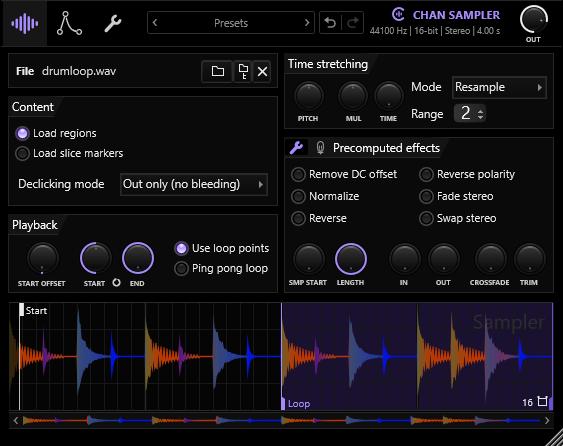

# Chan Sampler

Part of [Chan Sampler](../../README.md). A recreation of FL Studio's Sampler channel (FL Studio 26.1.7): its
controls, look and sound, null-tested against FL itself.

  

- [RESEARCH.md](RESEARCH.md): what the original is, the sources, the editor's layout and the known gaps.
- [MEASUREMENTS.md](MEASUREMENTS.md): every measured law (playback, effects, envelopes, LFOs, filters, time
  stretching, the editor's look and feel), the declined changes and the provenance.
- [NULLTESTS.md](NULLTESTS.md): the offline null-test suite against FL, in dB of residual.

## What it does

A sample is loaded, processed once by the precomputed effects, then played per note through the time stretcher, the
filter and the envelopes and LFOs.

| Stage | What it is |
|---|---|
| Sample | WAV (FL's compressed WAVs included), AIFF, FLAC, Ogg Vorbis, Opus and MP3, converted to the project rate; region and slice markers and loop points read from the file |
| Precomputed effects | normalize, reverse, fades, crossfade, trim, boost, EQ, ring mod, cut and resonance, reverb, stereo delay and pogo, baked into the sample off the audio thread |
| Playback | start offset, loop points, ping-pong loop and FL's six declicking modes, through FL's 30-tap interpolator |
| Time stretching | PITCH, MUL and TIME in Resample, Stretch, Stretch Pro, the e3 and e2 modes, slice stretch and slice map |
| Voice | envelopes and LFOs for volume, Mod X, Mod Y and pitch (an LFO for panning), eight filter types, tracking, mono, porta and slide |
| Misc | the arpeggiator with chords, the echo delay with fat mode, cut groups between instances |

## Using it

The root [README](../../README.md#usage) has the controls. Presets are `.cspreset` files in
`Documents/Chan Sampler/Presets`; FL Sampler presets (`.fst`) load with their sample.

## How close

The offline suite against FL: 82 cases, 65 NULL and 17 close, none diff; the worst is the envelope with tensions at
-46.2 dB ([NULLTESTS.md](NULLTESTS.md)). The in-FL null tests of each feature are beside its law in
MEASUREMENTS.md. The time-stretch modes cannot null (FL's engine is proprietary) and are compared by behaviour.

## Developer notes

- Tests: `ChanSamplerTests` (the engine), `ChanSamplerUiTests` (the editor and the undo history),
  `ChanSamplerHostTest` (the built VST3 hosted like a DAW, `tools/HostTest.cpp` at the repository root) and
  `ChanSamplerPlayTests` (the same VST3 playing a sample), all under ctest. Offline renders: `CsRender` (`tools/CsRender.cpp`); editor snapshots: `ChanSamplerSnapshot`
  (`tools/Snapshot.cpp`).
- Null tests against FL: `nulltest/` ([nulltest/README.md](nulltest/README.md); needs FL Studio and the tools
  built).
- `scripts/make_screenshots.py` at the repository root makes the screenshots with the snapshot tool.
